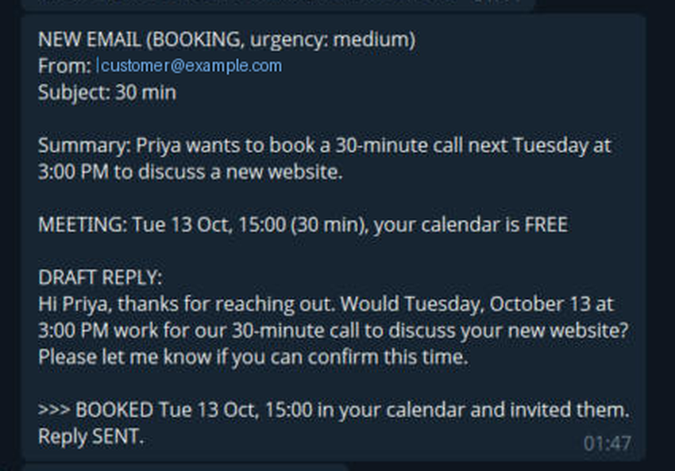
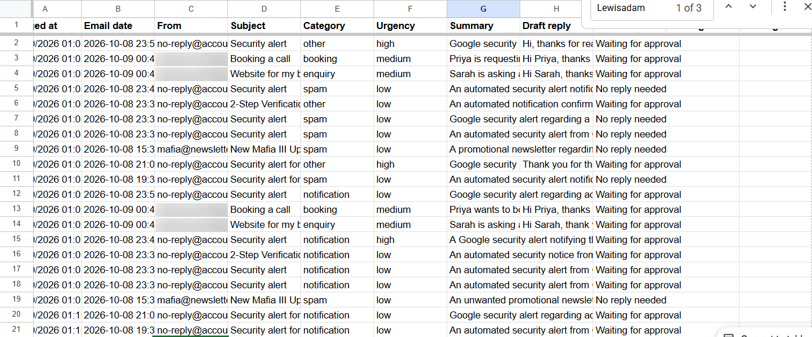
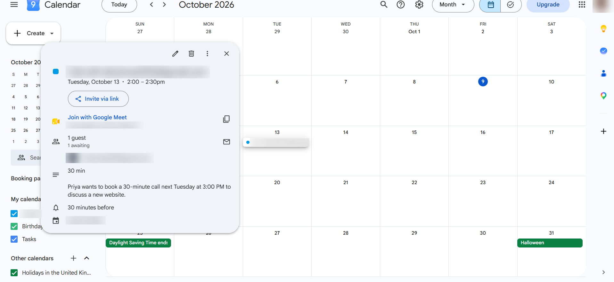
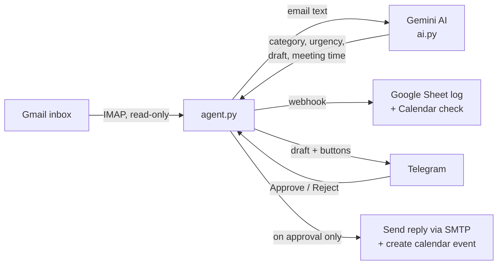
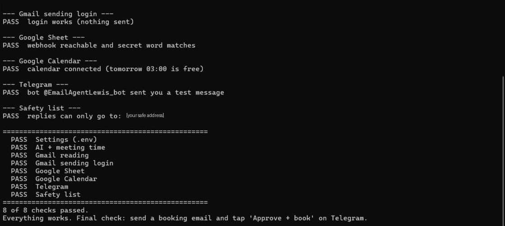

# AI Inbox & Admin Agent

An AI assistant for small businesses that reads the inbox, sorts every email, drafts replies and books meetings, but **never sends anything until a human approves it** on Telegram.

> 📹 **Demo video:** _add your link here_
>
> 

## What it does

1. **Reads new emails** from Gmail every 2 minutes (read-only, never marks anything as read)
2. **Sorts each email with AI** into enquiry, complaint, invoice, booking, notification, spam or other, and rates its urgency
3. **Drafts a reply** and, for booking requests, works out the meeting time ("next Tuesday at 3pm" → Tue 13 Oct, 15:00)
4. **Checks Google Calendar** to see whether that time is free
5. **Logs everything to Google Sheets** as a running record for the business owner
6. **Asks for approval on Telegram** with **Approve + book**, **Approve** and **Reject** buttons
7. **Only on approval:** sends the reply in the same email thread and creates the calendar event with an invite

| Google Sheet log | Calendar booking |
| --- | --- |
|  |  |

## How it works



## Accuracy

I built an evaluation suite of **52 labelled test emails**, including deliberately tricky ones like phishing disguised as an invoice, a bank fraud alert, polite complaints and a recruiter message.

| Test set | Category | Urgency | Meeting times |
| --- | --- | --- | --- |
| Development set (40 emails) | 37/40 → **40/40** after prompt improvements | 34/40 (85%) | 7/7 |
| **Hold-out set (12 unseen emails)** | **11/12 (92%)** | 10/12 (83%) | 2/2 |

The development set was used to improve the prompt. The hold-out set was **never** used for tuning, so it gives the honest score on emails the system hasn't seen. Full results: [first run](accuracy_reportv1.md), [after prompt fixes](accuracy_reportv3.md) and [hold-out set](accuracy_report_holdout.md).

**What the testing taught me:**
- Fixing one rule can break another (a **regression**). Telling the AI "anything about money is an invoice" fixed one email but made it file a bank fraud alert as spam. Re-running the full test after every change caught this.
- Setting `temperature: 0` made results far more consistent between runs.
- Some test labels depended on the day the test was run ("need it by Friday" on a Friday), so I rewrote them to be date-independent.

## Safety design

The AI only **suggests**. Code and humans **decide**.

- **Human-in-the-loop:** nothing is sent or booked without a tap on Telegram
- **Only the owner can approve:** button presses from any other Telegram chat are ignored
- **Safety list:** replies and calendar invites can only go to addresses listed in `SEND_ONLY_TO`
- **Hard rules in code, not the AI:** no replies are drafted to `no-reply` addresses, and meeting times are checked to be real future dates
- **Prompt rules:** drafts never promise prices, refunds or deadlines
- **Formula-injection protection:** email text starting with `=`, `+`, `-` or `@` can't run as a spreadsheet formula
- **Secrets stay local:** all keys live in `.env`, which is excluded from Git

## Reliability

- **Retry with backoff** when the AI service is busy (error 503/429), with automatic fallback to a second model
- **Telegram retries** on slow connections; approvals that can't be delivered are queued and resent
- **No duplicates:** handled emails are recorded in `processed.json`, so a crash or restart never logs or alerts twice
- **Pending approvals survive restarts** (`pending.json`)
- `selftest.py` checks all 8 components (settings, AI, Gmail read/send, Sheet, Calendar, Telegram, safety list) in about 30 seconds without sending anything



## Tech stack

Python · Google Gemini API · Gmail (IMAP/SMTP) · Google Apps Script (Sheets + Calendar webhook) · Telegram Bot API

## Project structure

| File | What it does |
| --- | --- |
| `agent.py` | Main loop: checks the inbox, sends approvals to Telegram, handles button presses |
| `ai.py` | Prompt, AI calls with retries, and code-level checks on the AI's output |
| `read_inbox.py` | Reads emails from Gmail over IMAP (read-only). Can also run alone as a one-off batch sort |
| `sheets.py` | Talks to Google Sheets and Calendar through the Apps Script webhook |
| `sheet_script.example.gs` | The Apps Script code that lives inside the Google Sheet |
| `accuracy_test.py` | Runs the 52 labelled test emails and scores the AI |
| `selftest.py` | Health check for every component |

## Setup

1. Install Python 3.10+, then:
   ```
   python -m venv venv
   venv\Scripts\activate
   pip install -r requirements.txt
   ```
2. Get a free Gemini API key from [Google AI Studio](https://aistudio.google.com).
3. Turn on 2-Step Verification on the Gmail account and create an **app password**.
4. Create a Google Sheet, open **Extensions → Apps Script**, paste in `sheet_script.example.gs`, set your own secret word, run `testSetup`, then **Deploy → Web app** (Execute as: Me, Access: Anyone).
5. Create a Telegram bot with [@BotFather](https://t.me/BotFather).
6. Copy `.env.example` to `.env` and fill it in.
7. Run `python selftest.py`, then `python agent.py`.

## Known limitations

- **Calm complaints are the weak spot.** "The phone number on my site is wrong" was sorted as an enquiry. Without angry language, the AI sometimes misses that something is broken. The next step is adding more examples like this to the development set.
- **Urgency is subjective,** so its accuracy (83–85%) is lower than category accuracy.
- Uses the **free Gemini tier**, which can be busy at peak times. The retry and fallback logic handles this, but replies can take longer.
- Runs on one machine. A production version would run on a server.

## Roadmap

- [ ] More "calm complaint" examples in the development set
- [ ] Edit the draft from Telegram before sending
- [ ] Weekly summary report: emails handled, response times, top requests
- [ ] Run on a VPS so it works 24/7

---

Built by Lewis Holmes ([LewisDigital](mailto:laholmes26@gmail.com)) with AI-assisted development. Every component was tested, debugged and understood step by step.
